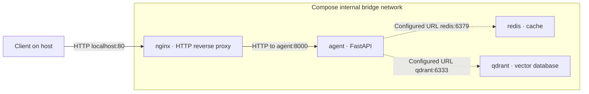

# Day 14 Lab - Mission Answers

## Part 1: Localhost vs Production

### Exercise 1.1: Anti-patterns found

1. Hardcode API Key, Secrets... in source code
2. Store config information in source code
3. Use print() instead of logging
4. Print API Key
5. Don't have health check
6. Hardcode host and port in source code to run only in localhost

### Exercise 1.2: Run the basic version

`POST /ask?question=Hello` returns HTTP 200 with a mock answer. The app is suitable for local testing. Production use requires moving secrets out of the source code and logs, configuring the host and port, and adding a health check.

### Exercise 1.3: Comparison table

| Feature      | Develop  | Production | Why Important?                                                                                                            |
| ------------ | -------- | ---------- | ------------------------------------------------------------------------------------------------------------------------- |
| Config       | Hardcode | Env vars   | Environment variables let each deployment use its own settings and keep secrets out of source code.                       |
| Health check |          |            | `/health` shows whether the app is running. `/ready` helps the load balancer route traffic to ready instances.            |
| Logging      | print()  | JSON       | Structured logs make events easier to filter and troubleshoot. Keeping API keys out of logs prevents accidental exposure. |
| Shutdown     | Đột ngột | Graceful   | Graceful shutdown gives in-flight requests time to finish, reducing interruptions during redeployments.                   |

## Part 2: Docker

### Exercise 2.1: Dockerfile questions

1. The base image is `python:3.11`.
2. The working directory inside the container is `/app`.
3. Copying `requirements.txt` first lets Docker reuse the dependency installation layer when only the application code changes.
4. `ENTRYPOINT` defines the executable. `CMD` supplies default arguments or, by itself, a default command. This Dockerfile uses `CMD ["python", "app.py"]`, which a command after the image name in `docker run` can override.

### Exercise 2.2: Build and run

- `my-agent:develop` uses **1.67 GB** of disk space (**1,667.78 MB**).

### Exercise 2.3: Image size comparison

- Develop: **1,667.78 MB**
- Production: **239.82 MB**
- Difference: **85.62% smaller** than develop

### Exercise 2.4: Docker Compose stack

- **Services.** Compose starts `nginx`, `agent`, `redis`, and `qdrant`.
- **Communication.** On the shared bridge network, services resolve each other by name. Nginx forwards requests from `localhost:80` to `agent:8000`. The dashed arrows show the Redis and Qdrant endpoints configured for the agent.

## Part 3: Cloud Deployment

### Exercise 3.1: Railway deployment

- URL: _Pending Part 6 deployment._
- Screenshot: _Pending CP6 endpoint tests._
- Verification commands: [DEPLOYMENT.md](DEPLOYMENT.md).

### Exercise 3.2: Railway and Render configuration

_Compare the two samples under `03-cloud-deployment/`. Check where each defines the build, start command, health path, and environment variables. Write why the files have different scopes._

### Exercise 3.3: Cloud Run pipeline

_Trace the steps in `cloudbuild.yaml` from the image build through deployment. Then check what `service.yaml` declares for container startup and runtime. Summarize in 3–5 lines._

## Part 4: API Security

### Exercise 4.1-4.3: Test results

- **4.1.** Locate the API key check in the develop app. Run one request without a key and one with the lab key. Record the status, relevant output, and how the key is rotated.
- **4.2.** On the production app, obtain a JWT from `POST /auth/token`. Record the authentication flow and redact the token in the output.
- **4.3.** Reuse the JWT for the local rate-limit test. Record when responses change from HTTP 200 to 429.

### Exercise 4.4: Cost guard implementation

_Describe where usage is recorded, how the budget period is chosen, when the budget is checked, and what HTTP status is returned after the budget is exhausted._

## Part 5: Scaling & Reliability

### Exercise 5.1-5.5: Implementation notes

- **5.1.** Compare responses from `/health` and `/ready`, including what changes when Redis is unavailable.
- **5.2.** Start a request, send SIGTERM to the serving process, and record whether the response finishes.
- **5.3.** Compare storing sessions in process memory with storing them in Redis.
- **5.4.** Start the stack with three agents and record which instances handle requests through Nginx.
- **5.5.** Run `test_stateless.py` against the stack and record what the returned history shows about shared state.

## Part 6: Production Readiness

_Paste the `Checklist Deliverable` from the full `check_production_ready.py` run on WSL2 with Docker._

## Part 7: Benchmark & Observability

Record the exercise results and measured evidence in [BENCHMARK_REPORT.md](BENCHMARK_REPORT.md).
